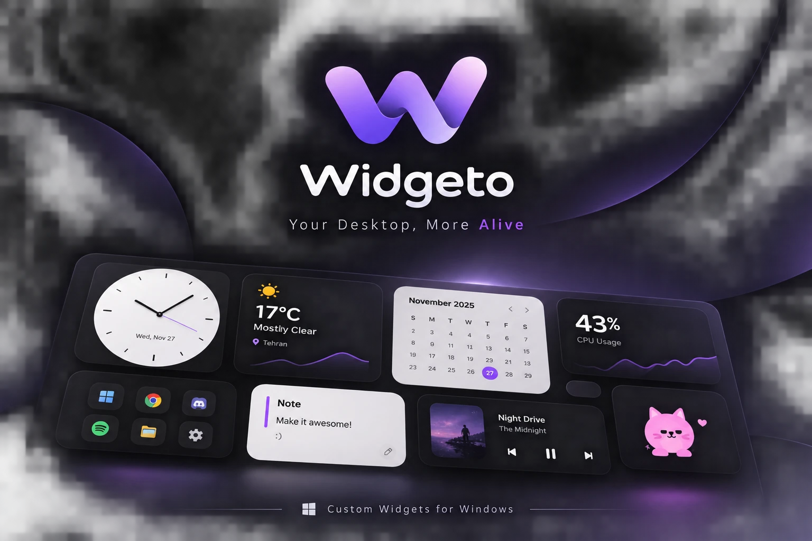

<p align="right" dir="rtl"><a href="README.md">English</a> · <strong>فارسی</strong></p>

<p align="center"></p>

<div dir="rtl">

# Widgeto

[](LICENSE)
[](#دانلود)
[](https://tauri.app)
[](https://mxqius.github.io/Widgeto/)

**[وب‌سایت ←](https://mxqius.github.io/Widgeto/)** · همه‌ی ویجت‌ها و Dynamic Island را همین‌جا در مرورگر ببینید.

ویجت‌های دسکتاپی که مستقیماً روی دسکتاپ شما زندگی می‌کنند، نه داخل یک پنجرهٔ برنامه. هر ویجت یک
پنجرهٔ مستقل، بدون کادر، شفاف و همیشه-روی-دسکتاپ خودِ سیستم‌عامل است. پنجرهٔ اصلی برنامه یک
مدیر (manager) است: آن‌ها را می‌چیند، اندازه می‌دهد، به لبه‌ها می‌چسباند، نشان می‌دهد و پنهان می‌کند.

## ویژگی‌ها

- **۱۲ ویجت واقعی** — ساعت، آب‌وهوا، سیستم، تقویم، وظایف، درحال‌پخش، یادداشت‌ها، تایمر تمرکز،
  بازارها، اجرای سریع، شبکه، برق، و یک حیوان خانگی متحرک کوچک
- **هیچ ویجتی ساختگی نیست** — سیستم، شبکه و باتری از ماشین واقعی خوانده می‌شوند؛ آب‌وهوا و بازارها
  از منابع دادهٔ عمومیِ زنده می‌آیند؛ یادداشت‌ها، وظایف و تقویم واقعی و محلی هستند
- **چسبیدن خودکار به لبه‌ها، خطوط راهنمای هم‌ترازی و چهار حالت چیدمان خودکار** (شبکه‌ای، ستونی، آبشاری، حلقه‌ای)
- **آگاه از چند‌مانیتوره بودن** — ناحیهٔ کاری هر نمایشگر به‌طور جداگانه دنبال می‌شود
- **در سینی سیستم (tray) زندگی می‌کند** — بستن پنجرهٔ مدیر آن را به سینی می‌فرستد؛ ویجت‌ها روی دسکتاپ می‌مانند
- **یک میان‌بر سراسری برای ثبت سریع**، تنظیمات هر ویجت، پروفایل‌ها، و یک مدیر که با صفحه‌کلید هم کار می‌کند
- **به‌روزرسانی خودکار داخلی** که می‌توانید خاموشش کنید — به بخش [به‌روزرسانی](#به‌روزرسانی) نگاه کنید

## دانلود

آخرین نصب‌کنندهٔ ویندوز (`Widgeto_<version>_x64-setup.exe`) را از **[آخرین انتشار](https://github.com/Mxqius/Widgeto/releases/latest)**
بردارید و اجرا کنید. بعد از نصب، Widgeto خودش را به‌روز نگه می‌دارد — به بخش [به‌روزرسانی](#به‌روزرسانی) نگاه کنید.

## اجرا از روی سورس

```bash
npm install
```

```bash
npm run app
```

هیچ سرویس جداگانه‌ای برای اجرا وجود ندارد — لایهٔ داده داخل هستهٔ Rust زندگی می‌کند.

پیش‌نمایش فقط-مرورگر از مدیر (بدون پنجره‌های واقعی دسکتاپ، اما نقشه، چسبیدن به لبه، چیدمان و
هر ویجت رندر می‌شود):

```bash
npm run dev
```

> سرور توسعه از **پورت ۳۴۲۰** استفاده می‌کند. پورت‌های ۱۴۲۰ و ۵۲۷۳ روی این ماشین داخل بازهٔ
> پورت‌های مسدود ویندوز قرار می‌گیرند، پس پورت پیش‌فرض Tauri جابه‌جا شده. اگر تغییرش دادید،
> در `vite.config.ts` و `src-tauri/tauri.conf.json` هر دو را با هم عوض کنید.

## به‌روزرسانی

Widgeto کمی پس از شروع و بعد از آن هر شش ساعت یک بار، با استفاده از به‌روزرسان امضاشدهٔ Tauri، نسخهٔ
جدیدتر را در GitHub Releases بررسی می‌کند — بدون هیچ تله‌متری، فقط یک بررسی نسخه در برابر همین مخزن.
وقتی نسخهٔ جدیدی پیدا شود، سه گزینه دارید: **دانلود و نصب**، **بعداً یادآوری کن** (در بررسی بعدی دوباره
می‌پرسد)، یا **رد کردن این نسخه**. اگر پنجرهٔ مدیریت در آن لحظه در سینی سیستم باشد، Dynamic Island با یک
پیام کوتاه خبر می‌دهد که به‌روزرسانی آماده است. بررسی خودکار را می‌توانید کاملاً از مسیر
**تنظیمات ← دسکتاپ و پنجره ← به‌روزرسانی‌ها** خاموش کنید؛ همان‌جا یک دکمهٔ «بررسی الان» هم هست.

## چیدمان کلی

```
main window            ─ مدیر: مالک همهٔ وضعیت‌ها، آن‌ها را ذخیره می‌کند
  └── DesktopMap       ─ نقشهٔ زندهٔ مقیاس‌شده از ناحیهٔ کاری مانیتور
  └── useDesktopSync   ─ پنجره‌های سیستم‌عامل را با استور هماهنگ می‌کند

w-<kind> windows       ─ یکی برای هر ویجت نمایان، widget.html?w=<kind>
                         بدون کادر · شفاف · بدون نوار وظیفه · همیشه در پایین
```

مدیر تنها منبع حقیقت است. پنجره‌های ویجت **کپی‌های فقط-خواندنی** هستند: هرگز مستقیماً در استور
ذخیره‌شده نمی‌نویسند (چون با هم بر سر یک کلید مشترک localStorage رقابت می‌کردند)، وضعیت را از
گذرگاه رویداد Tauri دریافت می‌کنند و فقط کاری را که کاربر انجام داده گزارش می‌دهند — یک کشیدن، یک
تغییر اندازه، یک پنهان‌سازی.

موقعیت‌ها **نسبت به ناحیهٔ کاری هر مانیتور** (بدون احتساب نوار وظیفه) ذخیره می‌شوند، پس چسبیدن به
لبه‌ها روی هر نمایشگری درست است و با تغییر رزولوشن هم از بین نمی‌رود؛ مبدأ صفحه فقط هنگام صحبت با
سیستم‌عامل اضافه می‌شود.

## سینی سیستم (Tray)

Widgeto در سینی سیستم زندگی می‌کند. بستن پنجرهٔ مدیر آن را آنجا پارک می‌کند — ویجت‌ها روی دسکتاپ
می‌مانند. کلیک چپ روی آیکون سینی، مدیر را برمی‌گرداند؛ کلیک راست منوی **باز کردن Widgeto**،
**نمایش همهٔ ویجت‌ها**، **پنهان کردن همهٔ ویجت‌ها** و **خروج** را می‌دهد. خروج از سینی تنها راهی
است که واقعاً برنامه را می‌بندد.

## مدیر

یک پنجرهٔ ۴۲۰×۶۴۰. بالای صفحهٔ اول تعداد ویجت‌های فعال را می‌شمارد و Arrange / Dock / Lock /
All-or-None را پیشنهاد می‌دهد؛ زیر آن، یک ردیف برای هر ویجت. زدن روی آیکون یک ویجت آن را روی
دسکتاپ می‌گذارد یا برمی‌دارد، S/M/L اندازه‌اش را تغییر می‌دهد و دکمهٔ اسلایدرها تنظیمات همان ویجت
را به‌صورت درون‌خطی باز می‌کند. یک فیلتر فعال/همه فهرست را کوتاه نگه می‌دارد. بومی برای چیدمان
وجود ندارد — هر ویجت را با کشیدن خودش جای‌گذاری می‌کنید.

## تنظیمات هر ویجت

| ویجت | تنظیمات |
| ------ | -------- |
| اجرای سریع (Quick Launch) | افزودن و حذف میان‌برها — یک سایت، یک `.exe.`، یک پوشه یا یک لینک `app://`. آیکون‌ها خودکار پیدا می‌شوند. |
| آب‌وهوا | شهر، که توسط ژئوکودر سرور تعیین می‌شود |
| بازارها | فهرست پیگیری، تا شش نماد |
| ساعت | متن زیرنویس، نمایش/عدم‌نمایش عقربهٔ ثانیه |
| تایمر تمرکز | مدت تمرکز / استراحت کوتاه / استراحت بلند |
| یادداشت‌ها | اندازهٔ متن |
| پت | نوع (گربه / خرگوش / بلاب / روباه)، نام و رنگ |

## لایهٔ داده

همه‌چیز **درون‌فرآیندی توسط هستهٔ Rust** واکشی و به‌صورت دستورهای Tauri عرضه می‌شود، پس نه
سرویس جانبی هست، نه پورتی، نه CORS و نه چیز اضافه‌ای برای اجرا یا ارسال.

| دستور | منبع |
| ------- | ------ |
| `weather(place)` | ژئوکدینگ و پیش‌بینی Open-Meteo |
| `markets(symbols)` | قیمت سادهٔ CoinGecko |
| `system_stats()` | `sysinfo` — پردازنده به‌ازای هسته، حافظه، دیسک، آپ‌تایم |
| `net_stats()` | `sysinfo` — توان عبوری واقعی، اندازه‌گیری‌شده بین دو نمونه‌برداری |
| `battery_stats()` | `starship-battery` — شارژ، سلامت، زمان باقی‌مانده |
| `media_now()` / `media_control(a)` | نشست رسانهٔ ویندوز (SMTC) |
| `launch(target)` | یک URL، فایل، پوشه یا اجرایی را باز می‌کند |
| `quote()` | نقل‌قول روز، قطعی برای هر روز |
| `whereami()` | موقعیت تقریبی بر اساس IP |
| `data_health()` | اندازهٔ کش، در تنظیمات نمایش داده می‌شود |

**هیچ ویجتی ساختگی نیست.** سیستم، شبکه و برق از ماشین واقعی خوانده می‌شوند؛ درحال‌پخش نشست
رسانهٔ واقعی را دنبال می‌کند و دکمه‌های کنترلش واقعاً آن را کنترل می‌کنند؛ ساعت، تقویم، وظایف،
یادداشت‌ها و تایمر تمرکز به‌صورت محلی واقعی‌اند؛ آب‌وهوا و بازارها از منابع زندهٔ بیرونی می‌آیند.
اجرای سریع سایت‌ها، فایل‌ها و برنامه‌های واقعی را باز می‌کند. تنها استثنا: اجرای پیش‌نمایش
فقط-مرورگر (`npm run dev`، بدون دسترسی به دستورهای Tauri) یا یک کش سرد با منبع بالادستی غیرقابل‌دسترس،
که در این دو حالت به یک کاشی «داده نمونه» با برچسب واضح بازمی‌گردد به‌جای شکست کامل.

هر دو منبع بالادستی بدون کلید API هستند. هر فراخوانی از یک کش TTL در `src-tauri/src/cache.rs`
عبور می‌کند که نقش پشتیبان را هم دارد: در صورت شکست منبع بالادستی، آخرین مقدار معتبر برگردانده
می‌شود، و هر پاسخ `source: "live" | "cache" | "stale"` به‌همراه سنِ آن را حمل می‌کند، پس یک کاشی
می‌تواند بگوید آخرین مقدار شناخته‌شده را نشان می‌دهد. فقط یک کش سرد می‌تواند شکست بخورد، و در آن
صورت ویجت داده نمونه نشان می‌دهد.

در سمت کلاینت، دستورها در TanStack Query (`src/app/widget/data/`) پیچیده شده‌اند که فاصلهٔ
واکشی مجدد، تلاش‌های مجدد و کش هر پنجره را مدیریت می‌کند. **axios عمداً حذف شده** — چون لایهٔ
داده درون‌فرآیندی است، دیگر HTTPای برای انجام دادن وجود ندارد؛ فقط `invoke` را در یک کش دوم
می‌پیچید.

بررسی‌های زنده در برابر منابع بالادستی واقعی کنار کد قرار دارند:

```bash
npm run test:data
```

پروب‌های ماشین هم پوشش داده شده‌اند، و آن‌ها نیازی به شبکه ندارند:

```bash
cd src-tauri && cargo test
```

## زبان طراحی

کاشی‌های یکنواخت squircle روی یک شبکهٔ مربعی، با دو کاشی دایره‌ای برای تضاد. هر کاشی یا مشکیِ
مسطح است یا سفیدِ مسطح — بدون شیشه، بدون درخشش، بدون شستشوی رنگ تاکید. هیچ سربرگ بخش یا برچسب
حروف‌بزرگی وجود ندارد: سلسله‌مراتب از اندازه و وزن تایپ می‌آید، پس محتوا *همان* ویجت است. یک
رنگ تاکید یگانهٔ مِجنتا فقط به‌ندرت ظاهر می‌شود (نوک متر، روز انتخاب‌شده، پرشدگی نوار پیشرفت).

عناصر تکرارشونده در `src/app/widget/ui/` هستند: `Say`/`Muted` برای جمله‌های تایپوگرافیک
با وزن ترکیبی، `TickMeter` برای مترهای علامت‌دار، `Line` برای اسکرابرهای نازک، `Stat` برای
اعداد بزرگ و `Row`/`Swatch` برای فهرست‌های تصویر کوچک.

کاشی‌ها به‌طور پیش‌فرض توپر هستند. حذف `backdrop-filter` از دوازده پنجرهٔ همیشه-روشن حدود
۲۶ مگابایت حافظهٔ GPU صرفه‌جویی می‌کند؛ در تنظیمات کدورت ویجت را زیر ۱۰۰٪ ببرید تا بلور برگردد.

## ۱۲ ویجت

ساعت · آب‌وهوا · سیستم · تقویم · وظایف · درحال‌پخش · یادداشت‌ها · تایمر تمرکز · بازارها ·
اجرای سریع · شبکه · برق · **پت**

پت یک موجود کوچک ساکن است، به یکی از چهار شکل: خودش نفس می‌کشد و پلک می‌زند، گوش‌هایش تیز
می‌شود و چشمانش نشانگر ماوس را دنبال می‌کند، وقتی کلیکش کنید می‌پرد و قلب پرتاب می‌کند، اگر در
چهار ثانیه سه بار نوازشش کنید واقعاً هیجان‌زده می‌شود (ستاره، لبخند بزرگ‌تر)، و بعد از مدتی
تنهایی چرت می‌زند — و با اولین لمس دوباره بیدار می‌شود.

**یک نمونه از هر کدام — ویجت‌ها قابل تکرار نیستند.** `kind` همان هویت است، استور دقیقاً یک
رکورد به‌ازای هر نوع نگه می‌دارد، و افزودن یا حذف فقط پرچم `open` را برمی‌گرداند، پس یک ویجت
موقعیت و اندازه‌اش را حتی وقتی پنهان است حفظ می‌کند. سه اندازهٔ مربعی یکنواخت (۱۷۶ / ۲۱۶ / ۲۶۴
پیکسل) و یک `theme` + `shape` برای هر نوع در `src/shared/widgets/kinds.ts` تعریف شده‌اند. یادداشت‌ها
و وظایف محتوای خود را حفظ می‌کنند.

## ویژگی‌های جای‌گذاری

**چسبیدن خودکار** — یک ویجت را (روی دسکتاپ، یا کارتش روی نقشهٔ مدیر) نزدیک هر یک از ۹ ناحیه
(۴ گوشه، ۴ لبه، مرکز) بکشید تا مغناطیسی گرفته شود. ویجت‌های چسبیده هنگام تغییر ناحیهٔ کاری دوباره
لنگر می‌اندازند. فاصلهٔ کشش قابل‌تنظیم است.

**خطوط راهنمای هم‌ترازی** — لبه‌ها و مرکزها با خطوط نقطه‌چین به ویجت‌های همسایه می‌چسبند، و در
نبود آن‌ها به چسبیدن به شبکه برمی‌گردند. چسبیدن به لبه بر هم‌ترازی برتری دارد، و هم‌ترازی بر
شبکه.

**چیدمان خودکار** — چهار حالت بسته‌بندی، اعمال‌شده روی هر نمایشگر:

- `grid` — بسته‌بندی قفسه‌ای به ترتیب خواندن، بدون هیچ همپوشانی
- `columns` — ستون‌های متوازن، هر ویجت به کوتاه‌ترین ستون
- `cascade` — چیدمان پلکانیِ آفست‌دار
- `ring` — مدار بیضی‌شکل

**لایهٔ دسکتاپ** — ویجت‌ها را پشت پنجره‌های دیگر بچسبانید (`alwaysOnBottom`، پیش‌فرض)، عادی
بگذارید، یا روی همه شناور کنید.

**چند‌مانیتوره** — ناحیهٔ کاری هر مانیتور دنبال می‌شود؛ ویجت‌ها یک اندیس نمایشگر حمل می‌کنند و
مدیر یک زبانه به‌ازای هر نمایشگر دارد.

## تعامل

| کجا | عمل |
| ----- | ------ |
| روی دسکتاپ | یک ویجت را برای جابه‌جایی بکشید · هاور برای تغییر اندازه / قفل / حذف |
| نقشهٔ مدیر | یک کارت را برای جای‌گذاری بکشید · دابل‌کلیک برای نمایش/پنهان‌سازی |
| فهرست مدیر | اندازه، قفل، نمایش/پنهان‌سازی، انتقال به نمایشگر دیگر |

| کلیدها | عمل |
| ---- | ------ |
| `Ctrl+,` | تنظیمات |
| `Ctrl+G` | چیدمان خودکار |
| `Ctrl+D` | چسباندن همه به لبه‌ها |
| `Ctrl+L` | قفل / بازکردن قفل همه |
| `Esc` | بستن روکش فعلی |

## تنظیمات

ظاهر (رنگ تاکید، کدورت کاشی، بلور، شعاع گوشه، والپیپر) · چیدمان و چسبیدن (فاصلهٔ کشش، حاشیه‌ها،
چسبیدن، حالت چیدمان، فاصله‌گذاری) · ویجت‌ها (قالب‌ها، نمونه‌ها) · دسکتاپ و پنجره (لایه، نمایش/پنهان
همه، به‌روزرسانی‌ها، همیشه-بالای مدیر، بازنشانی) · میان‌برها · درباره.

## چیدمان سورس

```
src/
  lib/layout.ts         چسبیدن به لبه، هم‌ترازی، چهار الگوریتم چیدمان
  lib/defaults.ts       تنظیمات پیش‌فرض، بدون وابستگی تا پنجرهٔ ویجت هم بتواند بخواندش
  lib/desktop.ts        مانیتورها، چرخهٔ عمر پنجرهٔ ویجت، قرارداد رویداد
  lib/useDesktopSync.ts پنجره‌های سیستم‌عامل را با استور هماهنگ می‌کند، یک گذر در هر بار
  store/useApp.ts       ویجت‌ها + تنظیمات + وضعیت به‌روزرسانی؛ فقط در پنجرهٔ مدیر ذخیره می‌شود
  components/           DesktopMap، ManagerChrome، WidgetLibrary، UpdateDialog، اجزای پایهٔ UI
  screens/               Manager، WidgetWindow، Settings
  lib/data.ts            پوشش‌های تایپ‌شده روی دستورهای دادهٔ Rust
  lib/queries.ts         هوک‌های TanStack Query، بازگشت‌های داده نمونه
  widgets/config.ts      تنظیمات هر ویجت و پیش‌فرض‌هایشان
  widgets/registry.ts    فقط ابرداده (بدون بدنه) تا مدیر کوچک بماند
  widgets/loader.ts      یک import پویا برای هر بدنهٔ ویجت
  widgets/               ۱۲ بدنه + بخش‌های مشترک + کانتکست تنظیمات
src-tauri/src/data.rs    دستورهای دادهٔ شبکه (آب‌وهوا، بازارها، نقل‌قول، ...)
src-tauri/src/system.rs  ماشین محلی: پردازنده، حافظه، دیسک، شبکه، باتری،
                         نشست رسانه، و اجرای برنامه‌ها
src-tauri/src/cache.rs   کش TTL با بازگشت به مقدار قدیمی
src-tauri/               پوستهٔ Rust، سینی سیستم، به‌روزرسان، مجوزها، آیکون‌ها
```

## نکات کارایی

**حافظه بیشتر تحت‌تأثیر تعداد فرآیندهاست تا کد.** هر ویجت رندرر جداگانهٔ WebView2 خودش را دارد
و هر رندرر تقریباً ۸۰ مگابایت هزینه دارد، صرف‌نظر از این‌که چقدر کم اجرا شود؛ پس دوازده ویجت
نزدیک ۱ گیگابایت می‌شوند. `--process-per-site` (در `src-tauri/src/lib.rs` تنظیم شده) هر
پنجرهٔ هم‌مبدأ را در یک رندرر کروم به‌جای یک رندرر جداگانه میزبانی می‌کند، که بی‌شک بزرگ‌ترین
اهرم موجود بدون تغییر معماری است — برنامه را از حدود ۱٫۵ گیگابایت به زیر ۶۰۰ مگابایت می‌رساند.
هزینه‌اش ایزوله‌سازی است: یک رندرر یعنی یک کرش کل ویجت‌ها را با خودش می‌برد، نه فقط یکی —
که برای یک تخته ویجتِ بیشتر-خواندنی هزینهٔ قابل‌قبولی است.

جابه‌جایی پنجره از سمت فرانت‌اند و با `setPosition` هدایت می‌شود، که همان چیزی است که چسبیدن
و لبه‌گیری را ممکن می‌کند (یک کشیدن بومی این کنترل را از دست می‌داد). روی ماشین کندتر، یک
کشیدن سریع ممکن است کمی از مکان‌نما عقب بماند.

## مشارکت

ایشو و پول‌ریکوئست خوش‌آمدند — برای نحوهٔ راه‌اندازی و ویژگی‌های یک PR خوب،
[CONTRIBUTING.md](CONTRIBUTING.md) را ببینید. باگی پیدا کردید؟
[یک ایشو باز کنید](https://github.com/mxqius/widgeto/issues).

## مجوز

MIT — به [LICENSE](LICENSE) نگاه کنید.

---

<p align="center">
  <a href="https://t.me/your_telegram_here">Telegram</a> ·
  <a href="https://github.com/your_github_here">GitHub</a> ·
  <a href="https://your-website.example">Website</a>
  <br>
  ساخته‌شده توسط <strong>MXQIUS</strong>
</p>

</div>
