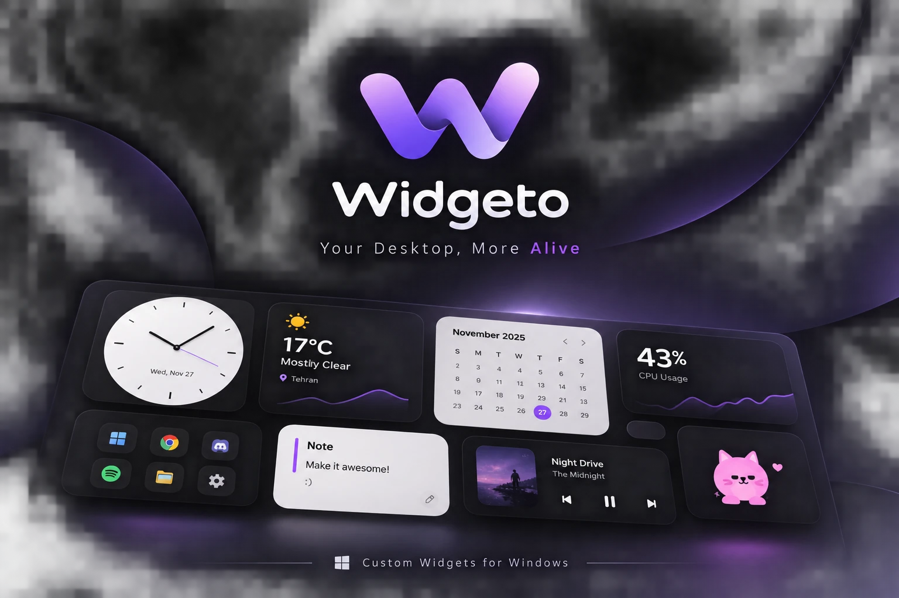

<p align="right"><a href="README.fa.md">فارسی</a> · <strong>English</strong></p>

<p align="center"></p>

# Widgeto

[](LICENSE)
[](#download)
[](https://tauri.app)
[](https://mxqius.github.io/Widgeto/)

**[Website →](https://mxqius.github.io/Widgeto/)** · see every widget and the Dynamic Island in action, right in your browser.

Desktop widgets that live **on your desktop**, not inside an app window. Each widget is its own
frameless, transparent, always-on-desktop OS window. The main app window is a manager: it places,
sizes, docks, shows and hides them.

## Features

- **12 real widgets** — Clock, Weather, System, Calendar, Tasks, Now Playing, Notes, Focus Timer,
  Markets, Quick Launch, Network, Power, and a small animated Pet
- **No widget is faked** — system, network and battery read the real machine; weather and markets
  come from live public data; Notes, Tasks and Calendar are real and local
- **Auto-dock, alignment guides and four auto-arrange modes** (grid, columns, cascade, ring)
- **A Dynamic Island** at the top of the screen — music, focus timer, system stats and today, with
  live pop-outs for track changes, the charger, finished timers and captured notes
- **Multi-monitor aware** — every display's work area is tracked independently
- **Lives in the tray** — closing the manager parks it there; the widgets stay on the desktop
- **A global capture hotkey**, per-widget settings, profiles, and a keyboard-first manager
- **Built-in auto-updates** you can turn off — see [Updating](#updating)

## Download

Grab the latest installer for your platform from the
**[Releases page](https://github.com/mxqius/widgeto/releases)**.

> The project is not published there yet — this link will work once the first release goes out.

## Run it from source

```bash
npm install
```

```bash
npm run app
```

There is no separate service to start — the data layer lives inside the Rust core.

Browser-only preview of the manager (no real desktop windows, but the map, docking, arranging and
every widget render):

```bash
npm run dev
```

> The dev server uses **port 7420**. Windows reserves shifting blocks of ports for Hyper-V and
> WSL (`netsh interface ipv4 show excludedportrange protocol=tcp` lists them), and Tauri's default
> 1420 — and later 3420 — fell inside them, so the port was moved clear of the usual ranges. Change
> it in `vite.config.ts` and `src-tauri/tauri.conf.json` together.

## Updating

Widgeto checks GitHub Releases for a newer version shortly after it starts and every six hours after
that, using Tauri's signed updater — no telemetry, just a version check against this repo. When one
is found you get a choice: **Download & Install**, **Remind me later** (asks again at the next check),
or **Skip this version**. If the manager is parked in the tray at the time, the Dynamic Island pops
out to say an update is ready.
Automatic checking can be turned off entirely in **Settings → Desktop & system → Updates**, which
also has a manual "Check for updates now" button.

## Project layout

```
src/
├── app/
│   ├── manager/   ← index.html    the manager window: store, board, settings
│   ├── widget/    ← widget.html   one widget, alone in its own desktop window
│   ├── capture/   ← capture.html  the quick-capture bar
│   └── island/    ← island.html   the Dynamic Island
└── shared/                        types, IPC, layout maths, tokens
```

Four HTML entries, one per window kind, and a hard rule between them: `app/*` may import
`shared/**` and nothing else of `app/*`. That boundary is not a convention — `npm run build` runs
`scripts/check-boundaries.mjs` first, which walks the static import graph from each entry (and from
each widget body, since those are lazily loaded and so invisible to an entry walk) and fails if
anything reaches a package it has no business loading.

The point is memory. A widget window is one of thirteen frames sharing a single renderer, so
anything it loads it loads thirteen times. Keeping the animation library, Base UI, the store and
tailwind-merge out of that graph is worth more than any amount of tidiness, and the guard is what
keeps them out once they are out.

```bash
npm run bundle-report   # what each window kind actually downloads and parses
```

## Dynamic Island

A black pill at the top centre of your main display that grows into whatever is going on.

| State | What it shows |
|---|---|
| Idle | The time, plus one quiet fact: charging, low battery, or the outside temperature |
| Music | The album cover and a live equaliser tinted with the cover's own colour |
| Focus timer | A progress ring and the time left; beside music it splits off into its own bubble |
| Hover | Opens into a panel with four tabs: **Now playing** (cover, title, source app, drag-to-seek, shuffle, previous / play / next, repeat off / all / one, and a system volume slider with mute), **Focus** (focus / break / long break, start, pause, reset, sessions today), **System** (CPU, memory, battery, network) and **Today** (time, date, weather) |
| Volume | Change the volume from the keyboard, the mixer or by **scrolling over the island**, and it shows a live volume bar |
| Privacy | A green dot while an app uses the camera, an orange one for the microphone, with the app's name in the open panel and a pop-out when one starts |
| Live activity | Pops out for a few seconds on a new track, charger in or out, low battery, a finished focus session (with a soft chime), a note saved from quick capture, an app turning on the mic or camera, or Caps Lock |

Every shape change is a CSS transition driven by real spring physics baked into a `linear()`
easing (`src/app/island/lib/spring.ts`), so the island needs no animation library. Its window is the
size of the largest shape and transparent around it; a small native watcher makes everything except
the island itself click-through, and tucks the island away while a full-screen game, video or
presentation is in front. Turn it off, or turn off the pop-outs, in
**Settings → Desktop & system → Dynamic Island**.

## Low-memory mode

**Settings → Appearance → Performance.** Off by default; the native half needs a restart.

It drops the tile blur, stretches every poll further, and hands compositing back to the CPU. On the
development machine, with all thirteen widgets on the desktop and the manager parked in the tray:

| | committed (private bytes) |
|---|---|
| default | ~342 MB |
| Low-memory mode | ~255 MB |

Worth knowing where that comes from, because it is not where you would guess. Measured on the same
box, the thirteen widget frames together cost about **57 MB** — roughly 4 MB each — on top of a
**~498 MB floor** that WebView2 charges for the browser, GPU, network and storage processes before a
single widget exists. Shrinking what each widget window downloads is worth doing for startup time
and for CPU, but it cannot move a number that is dominated by fixed runtime overhead. Turning off
GPU compositing can, because the GPU process alone is ~106 MB of that floor.

## How it fits together

```
main window            ─ the manager: owns all state, persists it
  └── DesktopMap       ─ scaled live map of the monitor work area
  └── useDesktopSync   ─ reconciles OS windows against the store

w-<kind> windows       ─ one per visible widget, widget.html?w=<kind>
                         frameless · transparent · skipTaskbar · alwaysOnBottom
```

The manager is the single source of truth. Widget windows are **read-only replicas**: they never
write to the persisted store (they'd race each other over one shared localStorage key), they receive
the state over Tauri's event bus, and they report back only what the user did — a drag, a size
cycle, a hide.

Positions are stored **relative to each monitor's work area** (taskbar excluded), so docking is
correct on any display and survives resolution changes; the screen origin is added only when talking
to the OS.

## Tray

Widgeto lives in the system tray. Closing the manager window parks it there — the widgets stay on
the desktop. Left-click the tray icon to bring the manager back; right-click for **Open Widgeto**,
**Show all widgets**, **Hide all widgets** and **Quit**. Quit from the tray is the only thing that
actually exits.

## The manager

A 420x640 window. The top of the first screen counts what is live and offers Arrange / Dock / Lock /
All-or-None; below that, one row per widget. Tapping a widget's icon puts it on the desktop or takes
it off, S/M/L sets its size, and the sliders button expands that widget's own settings inline. An
active/all filter keeps the list short once you have chosen your set. There is no layout canvas —
you place a widget by dragging the widget itself.

## Per-widget settings

| Widget | Settings |
| ------ | -------- |
| Quick Launch | Add and remove shortcuts — a site, an `.exe`, a folder, or an `app://` link. Favicons resolve automatically. |
| Weather | City, resolved by the server's geocoder |
| Markets | Watchlist, up to six tickers |
| Clock | Caption text, second hand on/off |
| Focus Timer | Focus / short / long durations |
| Notes | Text size |
| Pet | Species (cat / bun / blob / fox), name and colour |

## Data layer

Everything is fetched **in-process by the Rust core** and exposed as Tauri commands, so there is no
sidecar, no port, no CORS and nothing extra to run or ship.

| Command | Source |
| ------- | ------ |
| `weather(place)` | Open-Meteo geocoding + forecast |
| `markets(symbols)` | CoinGecko simple price |
| `system_stats()` | `sysinfo` — CPU per core, memory, disk, uptime |
| `net_stats()` | `sysinfo` — real throughput, measured between polls |
| `battery_stats()` | `starship-battery` — charge, health, time remaining |
| `media_now()` / `media_control(a)` | Windows media session (SMTC) |
| `launch(target)` | opens a URL, a file, a folder or an executable |
| `quote()` | quote of the day, deterministic per day |
| `whereami()` | coarse IP location |
| `data_health()` | cache size, surfaced in Settings |

**No widget is faked.** System, Network and Power read the real machine; Now Playing follows the
actual media session and its transport buttons drive it; Clock, Calendar, Tasks, Notes and Focus
Timer are real locally; Weather and Markets come from live upstreams. Quick Launch opens real
sites, files and applications. The only exception: running the browser-only preview (`npm run dev`,
no Tauri commands available) or a cold cache with an unreachable upstream falls back to a clearly
labelled "sample data" tile instead of failing outright.

Both upstreams are keyless. Every call goes through a TTL cache in `src-tauri/src/cache.rs` that
doubles as a fallback: on an upstream failure the last good value is returned instead, and each
response carries `source: "live" | "cache" | "stale"` plus an age, so a tile can say it is showing
the last known value. Only a cold cache can fail, and the widget then shows sample data.

On the client the commands are wrapped in TanStack Query (`src/app/widget/data/`), which owns the
refetch intervals, retries and per-window caching. It is loaded on demand: the six widgets that
never fetch anything never pull the query client into their window at all. **axios is deliberately absent** — with the data
layer in-process there is no HTTP for it to do; it would only wrap `invoke` in a second cache.

Live checks against the real upstreams live next to the code:

```bash
npm run test:data
```

The machine probes are covered too, and those need no network:

```bash
cd src-tauri && cargo test
```

## Design language

Uniform squircle tiles on a square grid, with two circular tiles for contrast. Every tile is either
flat near-black or flat white — no glass, no glow, no accent wash. There are no section headers or
uppercase labels: hierarchy comes from type size and weight, so the content *is* the widget. A
single magenta accent appears sparingly (meter tip, selected day, progress fill).

Recurring elements live in `src/app/widget/ui/`: `Say`/`Muted` for the mixed-weight typographic
sentences, `TickMeter` for tick-mark meters, `Line` for hairline scrubbers, `Stat` for big numerals
and `ListRow`/`Swatch` for thumbnail lists.

Tiles are solid by default. Dropping `backdrop-filter` from thirteen always-on windows is also
worth real GPU memory; turn tile opacity below 100% in Settings and the blur comes back, and
Low-memory mode takes it away again.

## The 12 widgets

Clock · Weather · System · Calendar · Tasks · Now Playing · Notes · Focus Timer · Markets ·
Quick Launch · Network · Power · **Pet**

The Pet is a small resident creature in one of four shapes: it breathes and blinks on its own, its
ears perk up and its eyes follow your cursor, it bounces and throws hearts when you click it, gets
properly excited (stars, wider grin) if you pet it three times in four seconds, and dozes off after
a while alone — waking the moment you touch it again.

**One of each — widgets cannot be duplicated.** `kind` is the identity, the store holds exactly one
entry per kind, and adding or removing just flips its `open` flag, so a widget keeps its position
and size while hidden. Three uniform square sizes (176 / 216 / 264 px) and a `theme` + `shape` per
kind are declared in `src/shared/widgets/kinds.ts`. Notes and Tasks keep their content.

## Placement features

**Auto-dock** — drag a widget (on the desktop, or its card on the manager's map) near any of the 9
zones (4 corners, 4 edges, centre) and it is captured magnetically. Docked widgets re-anchor when
the work area changes. Pull distance is configurable.

**Alignment guides** — edges and centres snap to neighbouring widgets with dashed guides, falling
back to grid snapping. Docking wins over aligning, which wins over the grid.

**Auto-arrange** — four packing modes, applied per display:

- `grid` — shelf packing in reading order, verified to produce zero overlaps
- `columns` — balanced columns, each widget to the shortest one
- `cascade` — offset stack
- `ring` — elliptical orbit

**Desktop layer** — pin widgets behind other windows (`alwaysOnBottom`, the default), leave them
normal, or float them on top.

**Multi-monitor** — every monitor's work area is tracked; widgets carry a display index and the
manager gets a tab per display.

## Interacting

| Where | Action |
| ----- | ------ |
| On the desktop | Drag a widget to move it · hover for resize / lock / remove |
| Manager map | Drag a card to place it · double-click to show/hide |
| Manager list | Size, lock, show/hide, move to another display |

| Keys | Action |
| ---- | ------ |
| `Ctrl+,` | Settings |
| `Ctrl+G` | Auto-arrange |
| `Ctrl+D` | Dock everything |
| `Ctrl+L` | Lock / unlock everything |
| `Esc` | Close overlay |

## Settings

Appearance (accent, tile opacity, blur, radius, wallpaper) · Layout & docking (pull distance,
margins, snapping, arrange mode, spacing) · Widgets (formats, instances) · Desktop & window (layer,
show/hide all, updates, manager always-on-top, reset) · Shortcuts · About.

## Source layout

```
src/
  lib/layout.ts         docking, alignment snapping, the four arrange algorithms
  lib/defaults.ts       default settings, dependency-free so widget windows can read them
  lib/desktop.ts        monitors, widget-window lifecycle, the event contract
  lib/useDesktopSync.ts reconciles OS windows against the store, one pass at a time
  store/useApp.ts       widgets + settings + update state; persisted only in the manager
  components/           DesktopMap, ManagerChrome, WidgetLibrary, UpdateDialog, ui primitives
  screens/               Manager, WidgetWindow, Settings
  lib/data.ts            typed wrappers over the Rust data commands
  lib/queries.ts         TanStack Query hooks, sample-data fallbacks
  widgets/config.ts      per-widget settings and their defaults
  widgets/registry.ts    metadata only (no bodies) so the manager stays small
  widgets/loader.ts      one dynamic import per widget body
  widgets/               the 12 bodies + shared parts + prefs context
src-tauri/src/data.rs    network data commands (weather, markets, quote, …)
src-tauri/src/system.rs  local machine: cpu, memory, disk, network, battery,
                         media session, and launching things
src-tauri/src/cache.rs   TTL cache with stale fallback
src-tauri/               Rust shell, tray, updater, capabilities, icons
```

## Performance notes

**Memory is dominated by process count, not by code.** Each widget is its own WebView2 renderer and
each renderer costs roughly 80 MB no matter how little it runs, so twelve widgets sit near 1 GB.
`--process-per-site` (set in `src-tauri/src/lib.rs`) hosts every same-origin window in one Chromium
renderer instead of one per window, which is by far the biggest lever available without changing
the architecture — it takes the app from roughly 1.5 GB to under 600 MB. The trade is isolation: one
renderer means a crash takes every widget with it rather than one tile, which is an acceptable trade
for a read-mostly widget board.

Window movement is driven from the frontend via `setPosition`, which is what makes snapping and
docking possible (a native drag would give up that control). On a slower machine a fast drag may
show slight lag behind the cursor.

## Contributing

Issues and pull requests are welcome — see [CONTRIBUTING.md](CONTRIBUTING.md) for how to get set up
and what makes a good PR. Found a bug? [Open an issue](https://github.com/mxqius/widgeto/issues).

## License

MIT — see [LICENSE](LICENSE).

---

<p align="center">
  <a href="https://t.me/your_telegram_here">Telegram</a> ·
  <a href="https://github.com/your_github_here">GitHub</a> ·
  <a href="https://your-website.example">Website</a>
  <br>
  Made by <strong>MXQIUS</strong>
</p>
